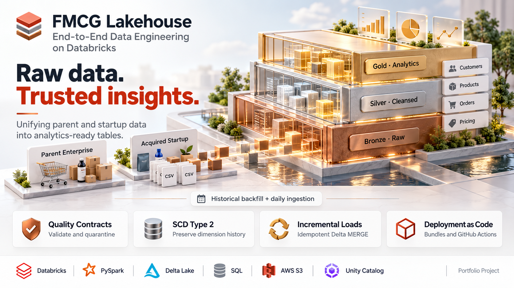
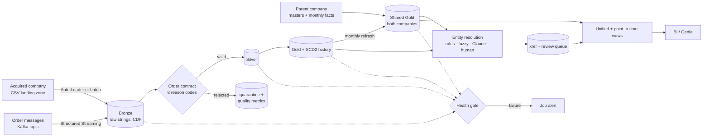
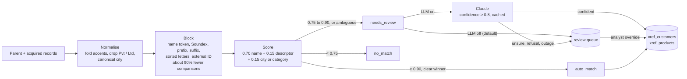

# merger-lakehouse

> Post-acquisition data platform on Databricks: entity resolution, exactly-once ingestion (files + Kafka), and reconciliation.




A Databricks Lakehouse (Bronze → Silver → Gold) that unifies the analytics of a parent FMCG company and a newly acquired startup,
with the parts a real merger needs and most tutorials skip: **deciding which customers and products the two companies share**,
exactly-once ingestion from files and Kafka, replay-safe backfills, reconciliation between layers, and reports that are correct as of any past date.

Extends [Mounusha25/databricks-fmcg-lakehouse-pipeline](https://github.com/Mounusha25/databricks-fmcg-lakehouse-pipeline) (MIT).
What came from there and what is new: [Origins and credit](#origins-and-credit).

**Stack:** Databricks (Unity Catalog, Lakeflow Jobs, Asset Bundles) · Delta Lake (MERGE, Change Data Feed, time travel, `OPTIMIZE ... ZORDER`) ·
Spark Structured Streaming (Auto Loader, Kafka) · Python 3.11 · pytest · GitHub Actions with OIDC · optional Claude API for ambiguous matches.

## At a glance

| | |
|---|---|
| **Scale exercised** | 19,997,914 raw order rows through the real notebooks on one laptop (local Spark + Delta, synthetic data) |
| **Incremental vs reload** | a 50,000-row day cost 10-14 s against 584 s for a full reload at 20M rows (41-58× cheaper) |
| **Entity matching** | customers precision 0.994 / recall 0.924, products 1.000 / 0.983, on fresh synthetic seeds. 4 wrong automatic matches in 20 scenarios, reported below |
| **Data quality** | every raw row is either valid or quarantined with a reason (8 batch codes + 1 streaming); `raw = valid + quarantined` is checked on every run |
| **Operations** | 9 jobs on dev and prod bundle targets; a health gate that reconciles Bronze, Silver, Gold and the shared tables and fails the run on any break |
| **Tests** | 170: 81 fast (all pass, 0.85 s) and 89 that run the real notebooks on local Spark (85 pass in 5 min; 4 need a Kafka broker and skip). On GitHub's runner one of the 85 fails, see [below](#what-has-and-has-not-been-verified) |
| **What is not verified** | stated in one table, [below](#what-has-and-has-not-been-verified): no Databricks run of the new jobs, no live Kafka broker, no live Claude call |

## The problem this solves

Loading the startup's customers into the parent's tables is the easy part. In a real acquisition the two companies already share
customers and sell near-identical products under different IDs and different spellings, so a naive merge double-counts them.
`Zenathlete Foods Pvt Ltd` in Bengaluru and `ZENATHLETE  FOODS` in Bangalore are one customer; `Primefuel Dairy` and `Primefuel Nutrition`
share a brand and are not.

The matcher's actual output on those cases (default weights, [`score_pair`](consolidated_pipeline/common/entity_resolution.py)):

| Parent record | Acquired record | Name | Descriptor | City | Score | Outcome |
|---|---|---:|---:|---|---:|---|
| Zenathlete Foods Pvt Ltd · Bengaluru | ZENATHLETE  FOODS · Bangalore | 1.00 | 1.00 | agree | 1.000 | auto match |
| Zenathlete Foods · Bengaluru | Zenathlet Foods · Bengaluru | 0.90 | 1.00 | agree | 1.000 | auto match (one-letter typo) |
| Primefuel Dairy · Pune | Primefuel Nutrition · Pune | 1.00 | 0.00 | agree | 0.850 | **human review** |
| Primefuel Dairy · Pune | Primefuel Nutrition · Mumbai | 1.00 | 0.00 | differ | 0.700 | no match |

<details>
<summary>Reproduce one row</summary>

```python
# from consolidated_pipeline/, in the project venv
from common.entity_resolution import CUSTOMER_PROFILE, MatchConfig, Record, prepare, score_pair

parent = prepare(Record("p", "Primefuel Dairy", "Pune"), CUSTOMER_PROFILE)
child = prepare(Record("c", "Primefuel Nutrition", "Pune"), CUSTOMER_PROFILE)
score_pair(child, parent, CUSTOMER_PROFILE, MatchConfig())   # score 0.85: goes to the review queue
```
</details>

### What it does

| Area | What it does | Where |
|---|---|---|
| **Entity resolution** | Matches acquired records to parent records: normalise, block, score, auto-match, optional Claude for the ambiguous band, human review queue with an override loop. Publishes `xref_customers` / `xref_products`. | [docs](docs/ENTITY_RESOLUTION.md), [code](consolidated_pipeline/common/entity_resolution.py) |
| **Exactly-once ingestion** | Auto Loader with `availableNow`; Bronze remembers which files it holds, so retries, replays and a reset checkpoint cannot duplicate or drop rows. Succeeds on days with no new files. | [docs](docs/OPERATIONS.md#why-a-file-is-never-loaded-twice-or-dropped), [code](consolidated_pipeline/common/order_ingestion.py) |
| **Kafka ingestion** | Order messages become the same micro-batches as files: per-message exactly-once (Bronze remembers topic, partition, offset and timestamp), malformed messages quarantined with their payload, unknown fields preserved. Scheduled drain by default. | [docs](docs/OPERATIONS.md#kafka-ingestion), [code](consolidated_pipeline/common/kafka_ingestion.py) |
| **Schema drift** | New source columns land in Bronze and are ignored downstream; a missing required column fails loudly after preserving the raw rows. | [docs](docs/OPERATIONS.md#schema-changes-in-the-source) |
| **Backfill** | Rebuild any order-date range from Bronze under the current rules with replace semantics; re-running converges. | [docs](docs/OPERATIONS.md#backfill) |
| **Health gate** | A job that reconciles Bronze↔Silver↔Gold, daily↔monthly, SCD2 integrity, orphans, cross-company code collisions, freshness and valid rate, failing the run (and the alert) on any break. | [docs](docs/OPERATIONS.md#the-health-gate), [code](consolidated_pipeline/common/quality_checks.py) |
| **Data contract** | Quarantine with reason codes per row; `contracts/orders.yml` is cross-checked against the code in CI, so the two cannot drift. | [contract](contracts/orders.yml) |
| **History** | SCD2 for customers and products; point-in-time joins that attach the customer/product as they were on the order date; Delta time travel kept 90 days. | [code](consolidated_pipeline/common/point_in_time.py) |
| **Unified reporting** | One row per real customer across both companies, one region hierarchy, pre/post-merger periods. | `vw_customers_unified`, `vw_orders_by_region_month` |
| **Deployment** | Databricks Asset Bundle with dev/prod targets, OIDC deployment, one-command demo. | [docs](docs/DEPLOYMENT.md) |

## Architecture



### Entity resolution



More detail, guarantees and deployment topology: [architecture/ARCHITECTURE.md](architecture/ARCHITECTURE.md).

### Guarantees and where they come from

| Guarantee | Mechanism |
|---|---|
| a file or message is ingested once | Auto Loader / Kafka checkpoint, then per-source-unit memory in Bronze |
| a replay changes nothing | MERGE on keys that updates only when a business value differs; deterministic run ids |
| bad rows are never silently lost | every raw row is valid or quarantined: `raw = valid + quarantined` is checked each run |
| layers agree | health gate: Silver↔Gold, daily↔monthly, Bronze→Gold recomputed independently |
| history is queryable | SCD2 validity windows, Delta time travel (90-day retention), Change Data Feed on Bronze and Silver |
| a missed load is noticed | `freshness_orders` in the 06:00 health job |

## Engineering decisions

Each of these has a reason recorded in the docs and, where it could be measured, a number.

- **Quarantine, do not repair.** A row that breaks the contract is kept with its raw values and reason codes; no fallback IDs are invented. The original landing zone
  fails an 80% gate at 79.13% valid, deliberately: that is the baseline the quarantine exists for.
- **Bronze remembers what it holds, instead of trusting a checkpoint.** Delta's `txnVersion` was rejected because after a checkpoint reset batch ids restart at zero and
  it would silently skip real data. Files are keyed on `(path, modification time)`; Kafka messages on `(topic, partition, offset, timestamp)`, with the timestamp there because a deleted and
  recreated topic restarts at offset 0 and its new messages would otherwise look already seen.
- **A health gate that compares promises.** Every check compares two things the pipeline already claims are equal (raw rows against valid plus quarantined, Silver against Gold,
  Gold against an independent recompute from Bronze), so a failure names the break instead of tripping a vague threshold.
- **Rules and fuzzy matching first, an LLM last, off by default.** The weights are hand-set and visible in `MatchConfig`. Claude sees only `{name, city or category}` for pairs in the review band;
  a reply below 0.8 confidence, a refusal or an outage never decides a pair; decisions are cached by pair, model and prompt version so reruns cost nothing and a deploy cannot flip earlier answers.
- **Evaluate on seeds you did not tune on.** Weights were set on *dev* seeds, *inspected* seeds are labelled optimistic, and only *fresh* seeds are quoted. The gap is visible: precision 1.000 on the tuning seeds, 0.994 on fresh ones.
- **Measure, then decline to claim.** `OPTIMIZE ... ZORDER` cut the files a query reads but not its wall-clock time on a laptop, so no speedup is claimed. The biggest cost in a full load
  (the quality-contract step, 62% of it at 20M rows) was measured but not changed, because those notebooks are the ones verified on Databricks Free Edition.
- **Scheduled micro-batches, not continuous streaming.** A 5,000-row micro-batch takes about 5-7 s end to end locally, so a 30-second continuous trigger would spend much of its time on fixed overhead.
  `availableNow` on a 15-minute schedule gives near-real-time freshness without an always-on cluster.

## Measured results

All of the numbers below were measured on one laptop (Apple M4, 10 cores, 16 GB) with open-source Spark 4.0.1 and Delta Lake 4.0.1
in local mode, on synthetic data. **They are not Databricks numbers and no cost was measured.** Method, caveats and the raw
JSON are in [docs/BENCHMARKS.md](docs/BENCHMARKS.md) and `benchmarks/results/`; the tables are generated from those files by `benchmarks/render_results.py`.

| history (raw order rows) | full load | rows/s | one 50k-row day, batch / Auto Loader | full reload ÷ one day |
|---:|---:|---:|---:|---:|
| 4,999,542 | 67.8 s | 73,701 | 14.7 s / 8.7 s | 4.6-7.8× |
| 19,997,914 | 584.3 s | 34,228 | 14.1 s / 10.0 s | 41-58× |

A **date bound on the MERGE condition** (5,000-row micro-batch, before any `OPTIMIZE`) took 7.09 s → 4.65 s at 20M rows, and no run of one setting overlapped a run of the other.
At 5M rows the same change read 5.30 s → 4.83 s, which is inside the roughly ±1.5 s run-to-run noise, so no benefit is claimed there.

Reading it honestly: the full load grew faster than the data (4× the rows took 8.6× as long), and the quality-contract step is 62% of it at 20M rows. A daily
increment barely notices the size of the history. `OPTIMIZE ... ZORDER` cut the files a selective query reads (11 → 3 at 5M, 11 → 6 at 20M) without a measurable wall-clock gain on a laptop,
so no speedup is claimed from it. The Auto Loader and batch notebooks cost about the same (identical repeat runs differed by about as much as the two notebooks did); Auto Loader is chosen for
correctness, not speed. Largest size measured: 20M rows.

### Entity matching

On synthetic merger scenarios with known truth, using **fresh seeds never used for tuning** (20 scenarios, about 1,200 acquired customers, 720 true matches):

| entity | precision (min / mean) | recall (min / mean) | resolved without a human |
|---|---:|---:|---:|
| customers | 0.969 / **0.994** | 0.861 / **0.924** | 91% |
| products | 1.000 / **1.000** | 0.905 / **0.983** | 99% |

What those averages hide, from the same run: there were **4 wrong automatic customer matches**, and **9 of 720 true matches (1.25%) were never compared at all** because blocking missed them
(typos that break every blocking key). The rest of what the matcher missed sits in the review queue. The labels come from the generator's own noise model, so this describes how well the matcher
undoes *that* noise, not how it will do on real data. Details and the exact method: [docs/ENTITY_RESOLUTION.md](docs/ENTITY_RESOLUTION.md#what-the-evaluation-measures).

### On the project's own data

Carried over from the previous README, not re-measured: a Databricks Free Edition run of the quality contract on the original local landing zone (not reproducible from this repo because `0_data/` is not
committed) saw 51,810 raw rows, 36,692 valid, 15,118 quarantined (70.82% valid), stored in `silver.order_quality_metrics`. The local pre-flight audit script reports 79.13% on the same files. The two
differ by design: the Spark contract also rejects product IDs that are not in the product dimension, which the audit has no table to check.

## What has and has not been verified

| | Status |
|---|---|
| Real notebooks (dimensions, full load, incremental, Auto Loader flow, backfill, entity resolution, quality gate, reporting) | **Run end to end on local Spark + Delta** against synthetic data; `make test-spark`. **85 passed, 4 skipped** (the real-broker Kafka tests) in 300 s on 2026-11-03. |
| Fast tests (contracts, bundle config, entity matching, SCD2 reference) | **81 passed** in 0.85 s on 2026-11-03; `make test` |
| Idempotency, replay, checkpoint reset, schema drift, backfill convergence, SCD2 point-in-time, time travel, every health check against the defect it exists to catch | Covered by tests |
| Original initial-load and daily-incremental jobs | Unchanged from the upstream versions verified on Databricks Free Edition |
| Databricks Auto Loader (`cloudFiles`) reader | **Not run.** Locally the stream uses Spark's `csv` file source; everything after the reader is the production path. |
| New bundle jobs (`bundle validate` / deploy / run) | **Not run on a workspace.** YAML structure is tested; the CLI was not available. |
| Kafka path | Parsing, malformed messages, per-message idempotency, replay, overlapping offsets, topic recreation and the stream wiring are tested **without a broker**. **The `format("kafka")` source against a real broker has not been run**; `make test-kafka` is written for that first run. |
| Claude adjudication | **Not run against the API.** Unit-tested with a fake client. Off by default. |
| GitHub Actions (2026-11-03) | The fast job passes. The real-notebook job on GitHub's Ubuntu runner ran **84 passed, 4 skipped, 1 failed**: `test_unknown_reader_and_trigger_are_rejected` builds a stream over `/tmp`, which that runner cannot fully read, before the trigger check it is meant to exercise. That is a test-isolation bug (and a validate-late ordering in `run_orders_kafka_stream`), not a data result. The 4 skips are the real-broker Kafka tests. |
| Entity-matching quality on real data | **Unknown.** Needs a hand-labelled sample (see docs). |

## Dashboard


*Gold-layer dashboard from the upstream project's Databricks Free Edition deployment, on that project's data. It was not produced by the code added in this repository.*

## Quick start

### Locally (no Databricks)

```bash
make venv          # Python env with Spark 4.0.1 + Delta 4.0.1 (needs a JDK 17+; Homebrew openjdk@21 works)
make test          # fast checks: contracts, bundle config, entity matching
make test-spark    # runs the real notebooks on local Spark against synthetic data (5 min on an M4, 7 on GitHub's runner)
make entity-eval   # entity-matching precision / recall
make benchmark ROWS=5000000
make kafka-up && make kafka-produce && make test-kafka   # needs Docker; never run yet, see docs/OPERATIONS.md#kafka-ingestion
```

### On Databricks

```bash
databricks auth login --profile fmcg-free
make deploy TARGET=dev PROFILE=fmcg-free     # synthetic merger demo end to end
```

### Pre-flight audit of a landing zone

Before a Databricks run you can check landed order files locally against the same contract:

```bash
python scripts/audit_orders.py '0_data/2_child_company/full_load/orders/landing/*.csv' \
  --output reports/full-load-quality.json --fail-under 0.80
```

Baseline from the original local sample (which `0_data/` is deliberately not committed for):

| Metric | Result |
|---|---:|
| Files scanned | 151 |
| Rows scanned | 51,810 |
| Valid rows | 40,997 (79.13%) |
| Duplicate records | 3,823 |
| Invalid customer IDs | 5,223 |
| Missing/invalid quantities | 2,607 |

That source intentionally fails an 80% gate: it is the baseline the quarantine exists for, not something to paper over with fallback IDs.

Without the demo data, the original flow still works: [docs/DEPLOYMENT.md](docs/DEPLOYMENT.md). Day-2 operations, cutover from the
batch job to Auto Loader, backfills and the review loop: [docs/OPERATIONS.md](docs/OPERATIONS.md). A two-minute walkthrough script: [docs/DEMO.md](docs/DEMO.md).

## Repository structure

```
consolidated_pipeline/
├── 1_setup/                    catalogs, date dimension, demo parent seed
├── 2_dimension_data_processing/ customers, products, pricing (SCD2 history for customers and products)
├── 3_fact_data_processing/     full load, daily batch, Auto Loader ingestion, Kafka ingestion, backfill
├── 4_entity_resolution/        match acquired to parent records
├── 5_quality/                  health gate
├── 6_reporting/                point-in-time and unified views
└── common/                     order contract, SCD2, ingestion, entity resolution, LLM adjudicator, checks, views
contracts/orders.yml            data contract, cross-checked against the code in CI
resources/jobs.yml, databricks.yml   bundle: nine jobs, dev and prod targets
local_lakehouse/                runs the notebooks on open-source Spark; synthetic data generator
benchmarks/                     scale benchmark, entity-matching evaluation, rendered results
tests/, tests/spark/            fast tests; real-notebook tests
docs/                           deployment, operations, entity resolution, benchmarks, demo script
```

## Data model

| Table | Grain | Notes |
|---|---|---|
| `silver.orders`, `silver.customers`, `silver.products` | order / customer / product | contract-valid, cleansed |
| `silver.quarantine_orders` | rejected row | raw values, `quarantine_reasons`, `pipeline_run_id`, `load_type` |
| `silver.order_quality_metrics` | run | raw / valid / quarantined counts and valid rate |
| `gold.sb_dim_customers`, `sb_dim_products` | current customer / product | current-state snapshots |
| `gold.sb_dim_customers_history`, `sb_dim_products_history` | version | SCD2: `dimension_sk`, `effective_from`, `effective_to`, `is_current` |
| `gold.sb_dim_gross_price` | product × effective month | price history, so joins use the price in force |
| `gold.sb_fact_orders` | order line | daily fact for the acquired company |
| `gold.dim_customers`, `dim_products`, `dim_gross_price`, `fact_orders` | customer / product / product-year / month | **shared** by both companies; `fact_orders` is monthly |
| `gold.xref_customers`, `xref_products` | source record | `unified_id`, match status, method, score |
| `silver.entity_match_*` | | review queue, overrides, labels, LLM cache, candidates, metrics |
| `silver.pipeline_check_results`, `gold.vw_data_health` | check | every health result and the latest per check |
| `gold.vw_fact_orders_pit`, `vw_customers_unified`, `vw_orders_by_region_month`, `vw_customer_overlap` | | reporting views |

## Monitoring queries

```sql
SELECT * FROM fmcg.gold.vw_data_health
ORDER BY CASE status WHEN 'fail' THEN 0 WHEN 'warn' THEN 1 ELSE 2 END, check_name;

SELECT reason, COUNT(*) AS rejected_rows
FROM (SELECT EXPLODE(quarantine_reasons) AS reason FROM fmcg.silver.quarantine_orders)
GROUP BY reason ORDER BY rejected_rows DESC;

SELECT * FROM fmcg.silver.entity_match_review_queue ORDER BY score DESC;

SELECT * FROM table_changes('fmcg.bronze.orders', 0);   -- row-level lineage (Change Data Feed)
```

## Notes

- **Synthetic data.** Tests, the benchmark and the demo use generated data (`local_lakehouse/synthetic.py`). The original sample CSVs
  are not in this repository.
- **Free Edition.** Development uses a managed Volume as the landing zone; production defaults to an S3 bucket
  (`s3://sportsbar-analytics/{data_source}/`). Free Edition runs on serverless compute, which cannot cache DataFrames; the new code
  caches only when allowed.
- **Shared tables.** `gold.fact_orders` and the shared dimensions hold both companies. Customer and product codes must be unique
  across them; the health gate checks this.
- **Known limits** (driver-side entity resolution capped at 200,000 records per side, no sub-second streaming, and others): [docs/OPERATIONS.md](docs/OPERATIONS.md#known-limits).

## Future enhancements

- Run the new jobs on a live workspace and record Databricks timings and cost per run
- Run the Kafka path against a real broker, then measure end-to-end latency and sustained throughput
- Sub-second streaming (continuous trigger) if a use case needs it; today's streams are scheduled micro-batch drains
- Hand-label a sample of the real customer master to measure entity-matching precision and recall
- Revenue views: the shared fact stores quantity, so unified reports are in units; joining `dim_gross_price` gives revenue
- Evaluate the quality contract once per load instead of several times (measured at 62% of a 20M-row full load), after re-verifying the notebooks on Databricks
- dbt for transformation orchestration; fine-grained Unity Catalog grants for multi-team deployments
