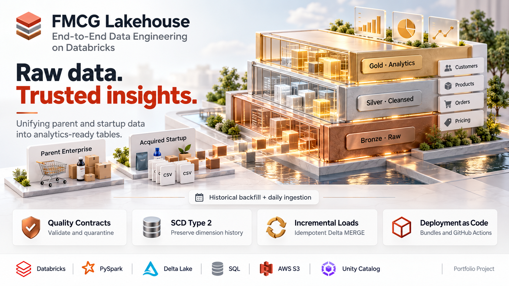
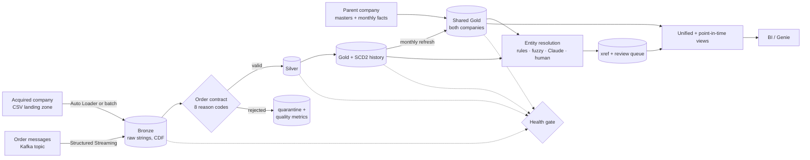
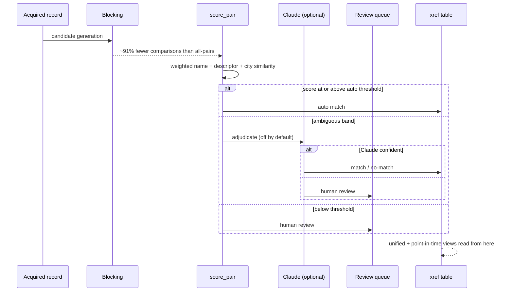

# merger-lakehouse — FMCG Lakehouse

> Post-acquisition data platform on Databricks: **entity resolution**, exactly-the-same-answer-on-replay ingestion (files + Kafka), and reconciliation between layers.




A Databricks Lakehouse (Bronze → Silver → Gold) that unifies the analytics of a parent FMCG company and a newly acquired startup, with the parts a real merger needs and most tutorials skip: **deciding which customers and products the two companies share**, replay-safe ingestion from files and Kafka, scoped backfills, reconciliation between layers, and reports that are correct as of any past date.

Extends [Mounusha25/databricks-fmcg-lakehouse-pipeline](https://github.com/Mounusha25/databricks-fmcg-lakehouse-pipeline) (MIT).

**Stack:** Databricks (Unity Catalog, Lakeflow Jobs, Asset Bundles) · Delta Lake (MERGE, Change Data Feed, time travel, `OPTIMIZE ... ZORDER`) · Spark Structured Streaming (Auto Loader, Kafka) · Python 3.11 · pytest · GitHub Actions with OIDC · optional Claude API for ambiguous matches.

---

## Highlights

- Architected a lakehouse for a **simulated FMCG merger**, unifying both companies in **Bronze/Silver/Gold Delta layers** with change-aware `MERGE` operations that keep full history — loading **20M rows in 584 seconds** and cutting MERGE micro-batches from **7.1 to 4.7 seconds** with a date-bound merge condition.
- Made a daily increment independent of history size: a **50,000-row day costs 10–14 seconds** against **584 seconds** for a full reload at 20M rows — **41–58× cheaper**.
- Extended the lakehouse with **Kafka** ingestion for the daily order pipeline, reusing Bronze-to-Gold transformations and quarantining invalid messages, with tests covering **duplicate-free replays**, overlapping offsets, topic recreation and checkpoint reset.
- Designed customer and product **entity resolution** with blocking that cuts pairwise comparisons by about **91%**, weighted similarity scoring, and optional LLM adjudication — averaging **99.4% precision / 92.4% recall** for customers and **100% / 98.3%** for products across **20 unseen synthetic scenarios** (~1,200 acquired customers, 720 true matches), resolving **91%** without human review.
- Enforced a quality contract where **every raw row is either valid or quarantined with a reason** — **8 batch codes plus 1 streaming code** — and `raw = valid + quarantined` is checked on every run.
- Operationalized **9 jobs** across dev and prod **Asset Bundle** targets deployed via **OIDC**, behind a health gate that reconciles Bronze, Silver, Gold and the shared tables and **fails the run on any break**.
- Modeled **SCD Type 2** history with point-in-time joins and **scoped backfills** that preserve unrelated company records, so a report can be correct as of any past date.
- Backed it with **170 tests**: **81 fast** (0.85 s) plus **89 that run the real notebooks on local Spark** (85 pass in 5 minutes; 4 need a Kafka broker and skip).
- Measured `OPTIMIZE ... ZORDER` honestly: it cut the files a selective query reads (11 → 3 at 5M rows, 11 → 6 at 20M) with **no measurable wall-clock gain on a laptop**, so no speedup is claimed from it.

---

## Architecture



## Entity resolution — how a pair is decided



The matcher's actual output on the hard cases (default weights, `score_pair`):

| Parent record | Acquired record | Score | Outcome |
|---|---|---:|---|
| Zenathlete Foods Pvt Ltd · Bengaluru | ZENATHLETE  FOODS · Bangalore | 1.000 | auto match |
| Zenathlete Foods · Bengaluru | Zenathlet Foods · Bengaluru | 1.000 | auto match (one-letter typo) |
| Primefuel Dairy · Pune | Primefuel Nutrition · Pune | 0.850 | **human review** |

---

## Measured results

Measured on one laptop (Apple M4, 10 cores, 16 GB) with open-source Spark 4.0.1 and Delta Lake 4.0.1 in local mode, on **synthetic data**. **These are not Databricks numbers and no cost was measured.** Method and raw JSON: `docs/BENCHMARKS.md` and `benchmarks/results/`.

| history (raw order rows) | full load | rows/s | one 50k-row day, batch / Auto Loader | full reload ÷ one day |
|---:|---:|---:|---:|---:|
| 4,999,542 | 67.8 s | 73,701 | 14.7 s / 8.7 s | 4.6–7.8× |
| 19,997,914 | 584.3 s | 34,228 | 14.1 s / 10.0 s | 41–58× |

A **date bound on the MERGE condition** (5,000-row micro-batch, before any `OPTIMIZE`) took **7.09 s → 4.65 s** at 20M rows. At 5M rows the same change read 5.30 s → 4.83 s, inside run-to-run noise, so no benefit is claimed there.

### Entity matching

20 scenarios on **fresh seeds never used for tuning**, ~1,200 acquired customers, 720 true matches.

| entity | precision (min / mean) | recall (min / mean) | resolved without a human |
|---|---:|---:|---:|
| customers | 0.969 / **0.994** | 0.861 / **0.924** | 91% |
| products | 1.000 / **1.000** | 0.905 / **0.983** | 99% |

What those averages hide, from the same run: **4 wrong automatic customer matches**, and **9 of 720 true matches (1.25%) were never compared at all** because blocking missed them. The labels come from the generator's own noise model, so this measures how well the matcher undoes *that* noise, not real data.

## What has and has not been verified

| | Status |
|---|---|
| Real notebooks (dimensions, full load, incremental, Auto Loader flow, backfill, entity resolution, quality gate, reporting) | **Run end to end on local Spark + Delta** against synthetic data — 85 passed, 4 skipped in 300 s |
| Fast tests (contracts, bundle config, entity matching, SCD2 reference) | **81 passed** in 0.85 s |
| Idempotency, replay, checkpoint reset, schema drift, backfill convergence, SCD2 point-in-time, time travel, health checks | Covered by tests |
| Databricks Auto Loader (`cloudFiles`) reader | **Not run.** Locally the stream uses Spark's `csv` file source; everything after the reader is the production path |
| New bundle jobs (`bundle validate` / deploy / run) | **Not run on a workspace.** YAML structure is tested |
| Kafka path | Parsing, malformed messages, idempotency, replay, overlapping offsets and stream wiring tested **without a broker**; `format("kafka")` against a real broker not yet run |
| Claude adjudication | **Not run against the API.** Unit-tested with a fake client. Off by default |
| Entity-matching quality on real data | **Unknown.** Needs a hand-labelled sample |

## Dashboard


*Gold-layer dashboard from the upstream project's Databricks Free Edition deployment, on that project's data. It was not produced by the code added in this repository.*

## Quick start

```bash
make setup && make test          # 81 fast tests, 0.85 s
```

```bash
make test-spark                  # 89 real-notebook tests on local Spark (~5 min)
```

```bash
make demo                        # generate synthetic data and run the pipeline locally
```

```bash
databricks bundle validate -t dev && databricks bundle deploy -t dev
```

## Notes

- **Synthetic data.** Tests, benchmarks and the demo use generated data (`local_lakehouse/synthetic.py`). Original sample CSVs are not in this repository.
- **Shared tables.** `gold.fact_orders` and the shared dimensions hold both companies; customer and product codes must be unique across them, and the health gate checks this.
- **Known limits** — driver-side entity resolution capped at 200,000 records per side, no sub-second streaming, and others: `docs/OPERATIONS.md`.

---

**Built by [Brijesh Kumar](https://github.com/Brijesh03032001)** · [Portfolio](https://brijeshbuilds.com) · [LinkedIn](https://linkedin.com/in/brijeshkumar03)
