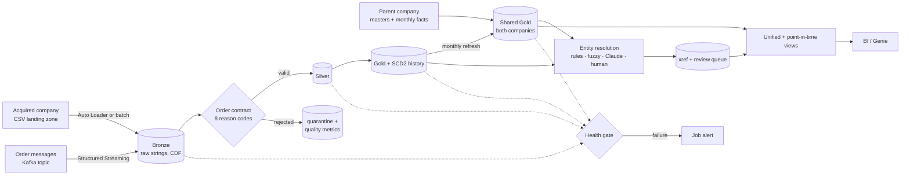

# merger-lakehouse

> Post-acquisition data platform on Databricks: entity resolution, exactly-once ingestion (files + Kafka), and reconciliation.


A Databricks Lakehouse (Bronze → Silver → Gold) that unifies the analytics of a parent FMCG company and a newly acquired startup,
with the parts a real merger needs and most tutorials skip: **deciding which customers and products the two companies share**,
exactly-once ingestion, replay-safe backfills, reconciliation between layers, and reports that are correct as of any past date.

## The problem this solves

Loading the startup's customers into the parent's tables is the easy part. In a real acquisition the two companies already share
customers and sell near-identical products under different IDs and different spellings, so a naive merge double-counts them.
`Zenathlete Foods Pvt Ltd` in Bengaluru and `ZENATHLETE  FOODS` in Bangalore are one customer.

### What this adds

| Area | What it does | Where |
|---|---|---|
| **Entity resolution** | Matches acquired records to parent records: normalise, block, score, auto-match, optional Claude for the ambiguous band, human review queue with an override loop. Publishes `xref_customers` / `xref_products`. | [docs](docs/ENTITY_RESOLUTION.md), [code](consolidated_pipeline/common/entity_resolution.py) |
| **Exactly-once ingestion** | Auto Loader with `availableNow`; Bronze remembers which files it holds, so retries, replays and a reset checkpoint cannot duplicate or drop rows. Succeeds on days with no new files. | [docs](docs/OPERATIONS.md#why-a-file-is-never-loaded-twice-or-dropped), [code](consolidated_pipeline/common/order_ingestion.py) |
| **Kafka ingestion** | Order messages become the same micro-batches as files: per-message exactly-once (Bronze remembers topic, partition, offset and timestamp), malformed messages quarantined with their payload, unknown fields preserved. Scheduled drain by default. | [docs](docs/OPERATIONS.md#kafka-ingestion), [code](consolidated_pipeline/common/kafka_ingestion.py) |
| **Schema drift** | New source columns land in Bronze and are ignored downstream; a missing required column fails loudly after preserving the raw rows. | [docs](docs/OPERATIONS.md#schema-changes-in-the-source) |
| **Backfill** | Rebuild any order-date range from Bronze under the current rules with replace semantics; re-running converges. | [docs](docs/OPERATIONS.md#backfill) |
| **Quality gate** | Quarantine with reason codes per row, a data contract checked in CI, and a health job that reconciles Bronze↔Silver↔Gold, daily↔monthly, SCD2 integrity, freshness and valid rate, failing the run (and the alert) on any break. | [docs](docs/OPERATIONS.md#the-health-gate), [contract](contracts/orders.yml) |
| **History** | SCD2 for customers and products; point-in-time joins that attach the customer/product as they were on the order date; Delta time travel kept 90 days. | [code](consolidated_pipeline/common/point_in_time.py) |
| **Unified reporting** | One row per real customer across both companies, one region hierarchy, pre/post-merger periods. | `vw_customers_unified`, `vw_orders_by_region_month` |
| **Deployment** | Databricks Asset Bundle with dev/prod targets, OIDC deployment, one-command demo. | [docs](docs/DEPLOYMENT.md) |

## Architecture



More detail, guarantees and deployment topology: [architecture/ARCHITECTURE.md](architecture/ARCHITECTURE.md).

## Measured results

All of the numbers below were measured on one laptop (Apple M4, 10 cores, 16 GB) with open-source Spark 4.0.1 and Delta Lake 4.0.1
in local mode, on synthetic data. **They are not Databricks numbers and no cost was measured.** Method, caveats and the raw
JSON are in [docs/BENCHMARKS.md](docs/BENCHMARKS.md) and `benchmarks/results/`.

| history (raw order rows) | full load | daily increment (50k rows) | full reload ÷ daily increment | MERGE date bound (5k-row micro-batch) |
|---:|---:|---:|---:|---:|
| 4,999,542 | 67.8 s (73,701 rows/s) | 8.7-14.7 s | 5-8× | 5.3 s → 4.83 s |
| 19,997,914 | 584.3 s (34,228 rows/s) | 10.0-14.1 s | 41-58× | 7.09 s → 4.65 s |

Reading it honestly: the full load grew faster than the data (4× the rows took 8.6× as long), and the quality-contract step is 62% of it at 20M rows. A daily
increment barely notices the size of the history. The MERGE date bound only started to matter at 20M rows. `OPTIMIZE ... ZORDER` cut the files a selective
query reads (11 → 3 at 5M, 11 → 6 at 20M) without a measurable wall-clock gain on a laptop, so no speedup is claimed from it. The Auto Loader and batch notebooks
cost about the same; Auto Loader is chosen for correctness, not speed. Largest size measured: 20M rows.

**Entity matching** on synthetic merger scenarios with known truth, fresh seeds never used for tuning (20 scenarios, about 1,200
acquired customers): customer precision 0.994 on average (worst scenario 0.969), recall 0.924, 91% resolved without a human; products
precision 1.000, recall 0.983. The labels come from the generator's own noise model, so this describes how well the matcher undoes
that noise, not how it will do on real data. Details and the exact method: [docs/ENTITY_RESOLUTION.md](docs/ENTITY_RESOLUTION.md).

**On the project's own data** (from the original local landing zone, not reproducible from this repo because `0_data/` is not
committed): a Free Edition run of the quality contract saw 51,810 raw rows, 36,692 valid, 15,118 quarantined (70.82% valid), stored in
`silver.order_quality_metrics`. The local pre-flight audit script reports 79.13% on the same files. The two differ by design: the Spark
contract also rejects product IDs that are not in the product dimension, which the audit has no table to check.

## What has and has not been verified

| | Status |
|---|---|
| Real notebooks (dimensions, full load, incremental, Auto Loader flow, backfill, entity resolution, quality gate, reporting) | **Run end to end on local Spark + Delta** against synthetic data; `make test-spark` |
| Idempotency, replay, checkpoint reset, schema drift, backfill convergence, SCD2 point-in-time, time travel, every health check against the defect it exists to catch | Covered by tests |
| Original initial-load and daily-incremental jobs | Unchanged from the versions previously verified on Databricks Free Edition |
| Databricks Auto Loader (`cloudFiles`) reader | **Not run.** Locally the stream uses Spark's `csv` file source; everything after the reader is the production path. |
| New bundle jobs (`bundle validate` / deploy / run) | **Not run on a workspace.** YAML structure is tested; the CLI was not available. |
| Kafka path | Parsing, malformed messages, per-message idempotency, replay, overlapping offsets, topic recreation and the stream wiring are tested **without a broker**. **The `format("kafka")` source against a real broker has not been run**; `make test-kafka` is written for that first run. |
| Claude adjudication | **Not run against the API.** Unit-tested with a fake client. Off by default. |
| Entity-matching quality on real data | **Unknown.** Needs a hand-labelled sample (see docs). |

## Quick start

### Locally (no Databricks)

```bash
make venv          # Python env with Spark 4.0.1 + Delta 4.0.1 (needs a JDK 17+; Homebrew openjdk@21 works)
make test          # fast checks: contracts, bundle config, entity matching
make test-spark    # runs the real notebooks on local Spark against synthetic data (~10 min)
make entity-eval   # entity-matching precision / recall
make benchmark ROWS=5000000
make kafka-up && make kafka-produce && make test-kafka   # needs Docker; never run yet, see docs/OPERATIONS.md#kafka-ingestion
```

### On Databricks

```bash
databricks auth login --profile fmcg-free
make deploy TARGET=dev PROFILE=fmcg-free     # synthetic merger demo end to end
```

### Pre-flight audit of a landing zone

Before a Databricks run you can check landed order files locally against the same contract:

```bash
python scripts/audit_orders.py '0_data/2_child_company/full_load/orders/landing/*.csv' \
  --output reports/full-load-quality.json --fail-under 0.80
```

Baseline from the original local sample (which `0_data/` is deliberately not committed for):

| Metric | Result |
|---|---:|
| Files scanned | 151 |
| Rows scanned | 51,810 |
| Valid rows | 40,997 (79.13%) |
| Duplicate records | 3,823 |
| Invalid customer IDs | 5,223 |
| Missing/invalid quantities | 2,607 |

That source intentionally fails an 80% gate: it is the baseline the quarantine exists for, not something to paper over with fallback IDs.

Without the demo data, the original flow still works: [docs/DEPLOYMENT.md](docs/DEPLOYMENT.md). Day-2 operations, cutover from the
batch job to Auto Loader, backfills and the review loop: [docs/OPERATIONS.md](docs/OPERATIONS.md). A two-minute walkthrough script: [docs/DEMO.md](docs/DEMO.md).

## Repository structure

```
consolidated_pipeline/
├── 1_setup/                    catalogs, date dimension, demo parent seed
├── 2_dimension_data_processing/ customers, products, pricing (SCD2 history for customers and products)
├── 3_fact_data_processing/     full load, daily batch, Auto Loader ingestion, Kafka ingestion, backfill
├── 4_entity_resolution/        match acquired to parent records
├── 5_quality/                  health gate
├── 6_reporting/                point-in-time and unified views
└── common/                     order contract, SCD2, ingestion, entity resolution, LLM adjudicator, checks, views
contracts/orders.yml            data contract, cross-checked against the code in CI
resources/jobs.yml, databricks.yml   bundle: nine jobs, dev and prod targets
local_lakehouse/                runs the notebooks on open-source Spark; synthetic data generator
benchmarks/                     scale benchmark, entity-matching evaluation, rendered results
tests/, tests/spark/            fast tests; real-notebook tests
docs/                           deployment, operations, entity resolution, benchmarks
```

## Data model

| Table | Grain | Notes |
|---|---|---|
| `silver.orders`, `silver.customers`, `silver.products` | order / customer / product | contract-valid, cleansed |
| `silver.quarantine_orders` | rejected row | raw values, `quarantine_reasons`, `pipeline_run_id`, `load_type` |
| `silver.order_quality_metrics` | run | raw / valid / quarantined counts and valid rate |
| `gold.sb_dim_customers`, `sb_dim_products` | current customer / product | current-state snapshots |
| `gold.sb_dim_customers_history`, `sb_dim_products_history` | version | SCD2: `dimension_sk`, `effective_from`, `effective_to`, `is_current` |
| `gold.sb_dim_gross_price` | product × effective month | price history, so joins use the price in force |
| `gold.sb_fact_orders` | order line | daily fact for the acquired company |
| `gold.dim_customers`, `dim_products`, `dim_gross_price`, `fact_orders` | customer / product / product-year / month | **shared** by both companies; `fact_orders` is monthly |
| `gold.xref_customers`, `xref_products` | source record | `unified_id`, match status, method, score |
| `silver.entity_match_*` | | review queue, overrides, labels, LLM cache, candidates, metrics |
| `silver.pipeline_check_results`, `gold.vw_data_health` | check | every health result and the latest per check |
| `gold.vw_fact_orders_pit`, `vw_customers_unified`, `vw_orders_by_region_month`, `vw_customer_overlap` | | reporting views |

## Monitoring queries

```sql
SELECT * FROM fmcg.gold.vw_data_health
ORDER BY CASE status WHEN 'fail' THEN 0 WHEN 'warn' THEN 1 ELSE 2 END, check_name;

SELECT reason, COUNT(*) AS rejected_rows
FROM (SELECT EXPLODE(quarantine_reasons) AS reason FROM fmcg.silver.quarantine_orders)
GROUP BY reason ORDER BY rejected_rows DESC;

SELECT * FROM fmcg.silver.entity_match_review_queue ORDER BY score DESC;

SELECT * FROM table_changes('fmcg.bronze.orders', 0);   -- row-level lineage (Change Data Feed)
```

## Notes

- **Synthetic data.** Tests, the benchmark and the demo use generated data (`local_lakehouse/synthetic.py`). The original sample CSVs
  are not in this repository.
- **Free Edition.** Development uses a managed Volume as the landing zone; production defaults to an S3 bucket
  (`s3://sportsbar-analytics/{data_source}/`). Free Edition runs on serverless compute, which cannot cache DataFrames; the new code
  caches only when allowed.
- **Shared tables.** `gold.fact_orders` and the shared dimensions hold both companies. Customer and product codes must be unique
  across them; the health gate checks this.

## Future enhancements

- Run the new jobs on a live workspace and record Databricks timings and cost per run
- Run the Kafka path against a real broker, then measure end-to-end latency and sustained throughput
- Sub-second streaming (continuous trigger) if a use case needs it; today's streams are scheduled micro-batch drains
- Hand-label a sample of the real customer master to measure entity-matching precision and recall
- Revenue views: the shared fact stores quantity, so unified reports are in units; joining `dim_gross_price` gives revenue
- dbt for transformation orchestration; fine-grained Unity Catalog grants for multi-team deployments

## License

MIT License.
