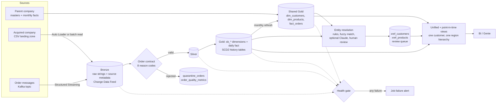

# Lakehouse architecture



## Layers

| Layer | Holds | Notes |
|---|---|---|
| Bronze | every landed file or message, columns kept as strings, plus its source metadata (file path and modification time, or Kafka topic, partition, offset and timestamp) and, for Kafka, the raw payload | append-only; remembers which files or messages it has, so ingestion is idempotent per source unit. One table per path: `orders`, `orders_raw`, `orders_kafka` |
| Silver | contract-valid rows with a resolved `product_code` | MERGE on business keys, rewritten only when a business value changes |
| Quarantine | rejected rows with their raw values and reason codes | one run id per micro-batch, so retries replace their own rows |
| Gold | `sb_dim_*` current dimensions, `sb_dim_*_history` SCD2, `sb_fact_orders` (daily), `sb_dim_gross_price` | |
| Shared Gold | `dim_customers`, `dim_products`, `dim_gross_price`, `fact_orders` (monthly) | the parent and acquired companies in one table; parent rows are never modified by the acquired company's loads |
| Cross-reference | `xref_customers`, `xref_products` | one row per source record: `unified_id`, match status, method, score |
| Reporting | `vw_fact_orders_pit`, `vw_customers_unified`, `vw_orders_by_region_month`, `vw_customer_overlap`, `vw_data_health` | views over the tables above |

## Processing patterns

**Dimensions**: Bronze → cleanse and deduplicate → Silver → current snapshot + SCD2 history (hash of tracked attributes, expire
the changed version and insert the new one in a single staged MERGE) → merge into the shared dimension.

**Orders, batch notebooks** (the Free Edition demo path): read the landing folder, append Bronze, apply the contract, MERGE
Silver and Gold, recompute affected months, move the files to `processed/`.

**Orders, Auto Loader**: stream with `availableNow`, and for each micro-batch: append to Bronze the files it does not already hold,
apply the contract, MERGE Silver and Gold (with a date bound so Delta can skip files), recompute the affected months in the
shared fact. No new files means no batches and a successful run.

**Orders, Kafka**: the same micro-batch path fed by a Structured Streaming Kafka source. Each message becomes an order row with its payload kept; messages with no order fields are quarantined as `malformed_message`; Bronze is idempotent per (topic, partition, offset, timestamp).

**Backfill**: re-derive an order-date range from Bronze and *replace* that range in Silver, Gold and quarantine; recompute and
delete stale monthly rows for the child's customers only.

**Entity resolution**: normalise → block → score → decide, with an analyst override table feeding back into the next run.

## Guarantees and where they come from

| Guarantee | Mechanism |
|---|---|
| a file or message is ingested once | Auto Loader / Kafka checkpoint, then per-source-unit memory in Bronze |
| a replay changes nothing | MERGE on keys that updates only when a business value differs; deterministic run ids |
| bad rows are never silently lost | every raw row is valid or quarantined: `raw = valid + quarantined` is checked each run |
| layers agree | health gate: Silver↔Gold, daily↔monthly, Bronze→Gold recomputed independently |
| history is queryable | SCD2 validity windows, Delta time travel (90-day retention), Change Data Feed on Bronze and Silver |
| a missed load is noticed | `freshness_orders` in the 06:00 health job |

## Deployment topology

```
GitHub / local checkout
   ├─ bundle validate
   ├─ bundle deploy ── dev  → fmcg_dev (schedules paused)
   └─ bundle deploy ── prod → fmcg     (daily load 02:00 UTC, health check 06:00 UTC)
                                │
                                ├─ initial load (manual)            ├─ Auto Loader ingestion (paused until cutover)
                                ├─ daily batch incremental (02:00)  ├─ Kafka ingestion (paused until a broker is set)
                                ├─ entity resolution (manual)       ├─ backfill (manual)
                                └─                                  └─ data health (06:00)
```

Both targets deploy the same versioned notebooks. Catalog, landing location, date range, thresholds, alert recipients and schedule
state are bundle variables, not source edits.
